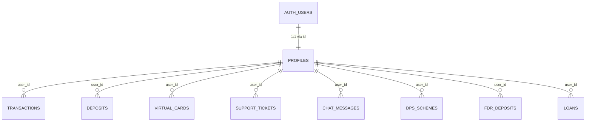

# Database Table Schema Reference

This document provides a complete reference for all tables, fields, relationships, and common query patterns for the project database (Supabase / PostgreSQL).

---

## 1. Entity-Relationship Overview



---

## 2. Table Definitions

### Table: `public.profiles`
Stores user profile information, account identifiers, and financial balances. Linked 1:1 with `auth.users`.

| Column | Data Type | Constraints / Default | Description |
| :--- | :--- | :--- | :--- |
| `id` | `UUID` | `PRIMARY KEY`, references `auth.users(id) ON DELETE CASCADE` | Matches the Supabase Auth user UUID |
| `username` | `TEXT` | `UNIQUE NOT NULL` | Unique user handle |
| `full_name` | `TEXT` | `NOT NULL` | Full legal name |
| `email` | `TEXT` | | Primary contact email |
| `account_number` | `TEXT` | `UNIQUE NOT NULL` | 11-digit bank account number (`1957...`) |
| `phone` | `TEXT` | | Contact telephone number |
| `country` | `TEXT` | `DEFAULT 'United States'` | Registered country |
| `address` | `TEXT` | | Billing / physical address |
| `balance` | `NUMERIC(14, 2)` | `DEFAULT 8.00` | Current available account balance |
| `kyc_status` | `TEXT` | `DEFAULT 'approved'` | Options: `'approved'`, `'pending'`, `'unverified'` |
| `two_factor_enabled` | `BOOLEAN` | `DEFAULT FALSE` | Two-factor authentication status |
| `referral_code` | `TEXT` | `UNIQUE` | Unique code used to refer others |
| `referral_count` | `INT` | `DEFAULT 0` | Total number of successful referrals |
| `referral_bonus` | `NUMERIC(14, 2)` | `DEFAULT 0.00` | Accrued referral earnings |
| `created_at` | `TIMESTAMPTZ` | `DEFAULT NOW()` | Record creation timestamp |
| `updated_at` | `TIMESTAMPTZ` | `DEFAULT NOW()` | Last update timestamp |

---

### Table: `public.transactions`
Primary ledger for all account credits, debits, transfers, fees, and bonuses.

| Column | Data Type | Constraints / Default | Description |
| :--- | :--- | :--- | :--- |
| `id` | `UUID` | `PRIMARY KEY DEFAULT gen_random_uuid()` | Unique transaction ID |
| `user_id` | `UUID` | `REFERENCES profiles(id) ON DELETE CASCADE` | Target user account UUID |
| `trx_id` | `TEXT` | `UNIQUE NOT NULL` | Unique reference code (e.g. `TRX9A8B7C...`) |
| `type` | `TEXT` | `NOT NULL` | Type: `'deposit'`, `'transfer'`, `'withdraw'`, `'dps'`, `'fdr'`, `'loan'`, `'bill'`, `'bonus'` |
| `title` | `TEXT` | `NOT NULL` | Readable summary title |
| `amount` | `NUMERIC(14, 2)` | `NOT NULL` | Principal amount |
| `charge` | `NUMERIC(14, 2)` | `DEFAULT 0.00` | Associated fee / surcharge |
| `status` | `TEXT` | `DEFAULT 'pending'` | Status: `'success'`, `'pending'`, `'failed'` |
| `method` | `TEXT` | `NOT NULL` | Origin/destination method (e.g. `'Wire'`, `'Bitcoin deposit'`, `'System'`) |
| `details` | `TEXT` | | Memo, counterparty details, or notes |
| `created_at` | `TIMESTAMPTZ` | `DEFAULT NOW()` | Transaction timestamp |

---

### Table: `public.deposits`
Bitcoin and Cash deposit requests requiring administrative confirmation or proof of payment.

| Column | Data Type | Constraints / Default | Description |
| :--- | :--- | :--- | :--- |
| `id` | `UUID` | `PRIMARY KEY DEFAULT gen_random_uuid()` | Unique deposit entry ID |
| `user_id` | `UUID` | `REFERENCES profiles(id) ON DELETE SET NULL` | Depositing user ID |
| `trx_id` | `TEXT` | `UNIQUE NOT NULL` | Tracking transaction ID |
| `method` | `TEXT` | `NOT NULL` | `'Bitcoin deposit'` or `'Cash deposit'` |
| `amount` | `NUMERIC(14, 2)` | `NOT NULL` | Deposited amount in USD |
| `charge` | `NUMERIC(14, 2)` | `NOT NULL` | Transaction fee |
| `payable_btc` | `NUMERIC(18, 8)` | | Exact BTC amount due |
| `wallet_address` | `TEXT` | `DEFAULT 'bc1qed0jznt...'` | Deposit target Bitcoin address |
| `proof_file_url` | `TEXT` | | Uploaded receipt / proof document URL |
| `status` | `TEXT` | `DEFAULT 'pending'` | Status: `'pending'`, `'confirmed'`, `'rejected'` |
| `created_at` | `TIMESTAMPTZ` | `DEFAULT NOW()` | Submission timestamp |

---

### Table: `public.virtual_cards`
Virtual credit / debit card generation, limits, and unlock states.

| Column | Data Type | Constraints / Default | Description |
| :--- | :--- | :--- | :--- |
| `id` | `UUID` | `PRIMARY KEY DEFAULT gen_random_uuid()` | Unique card record ID |
| `user_id` | `UUID` | `REFERENCES profiles(id) ON DELETE CASCADE` | Owner profile ID |
| `card_number` | `TEXT` | `NOT NULL` | 16-digit card number |
| `card_holder` | `TEXT` | `NOT NULL` | Full name embossed on card |
| `expiry` | `TEXT` | `NOT NULL` | Expiry date string (`MM/YY`) |
| `cvv` | `TEXT` | `NOT NULL` | 3-digit security code |
| `card_type` | `TEXT` | `DEFAULT 'Visa'` | `'Visa'`, `'Mastercard'` |
| `tier` | `TEXT` | `DEFAULT 'Platinum'` | Tier: `'Standard'`, `'Platinum'`, `'Black'` |
| `is_frozen` | `BOOLEAN` | `DEFAULT FALSE` | Whether card is temporarily blocked |
| `is_paid` | `BOOLEAN` | `DEFAULT FALSE` | Card activation fee paid flag |
| `creation_fee` | `NUMERIC(14, 2)` | `DEFAULT 50.00` | Activation fee required to reveal details |
| `spend_limit` | `NUMERIC(14, 2)` | `DEFAULT 5000.00` | Spending cap |
| `spent` | `NUMERIC(14, 2)` | `DEFAULT 0.00` | Cumulative amount spent |
| `created_at` | `TIMESTAMPTZ` | `DEFAULT NOW()` | Card issue timestamp |

---

### Table: `public.support_tickets`
Helpdesk and client support inquiries.

| Column | Data Type | Constraints / Default | Description |
| :--- | :--- | :--- | :--- |
| `id` | `UUID` | `PRIMARY KEY DEFAULT gen_random_uuid()` | Ticket ID |
| `user_id` | `UUID` | `REFERENCES profiles(id) ON DELETE SET NULL` | Requesting user |
| `ticket_number`| `TEXT` | `UNIQUE NOT NULL` | Ticket reference number |
| `subject` | `TEXT` | `NOT NULL` | Issue title / subject |
| `precedence` | `TEXT` | `DEFAULT 'Low'` | Priority: `'Low'`, `'Medium'`, `'High'` |
| `message` | `TEXT` | `NOT NULL` | In-depth description of the issue |
| `image_url` | `TEXT` | | Optional attachment / screenshot |
| `status` | `TEXT` | `DEFAULT 'Open'` | Status: `'Open'`, `'Pending'`, `'Resolved'`, `'Closed'` |
| `created_at` | `TIMESTAMPTZ` | `DEFAULT NOW()` | Submission timestamp |
| `updated_at` | `TIMESTAMPTZ` | `DEFAULT NOW()` | Last update timestamp |

---

### Table: `public.chat_messages`
Live support messaging logs.

| Column | Data Type | Constraints / Default | Description |
| :--- | :--- | :--- | :--- |
| `id` | `UUID` | `PRIMARY KEY DEFAULT gen_random_uuid()` | Message ID |
| `session_id` | `TEXT` | `NOT NULL` | Chat thread / session identifier |
| `user_id` | `UUID` | `REFERENCES profiles(id) ON DELETE SET NULL` | Author user ID (null for anonymous/system) |
| `sender_name` | `TEXT` | `NOT NULL` | Display name of sender |
| `sender_role` | `TEXT` | `DEFAULT 'user'` | Role: `'user'`, `'support'`, `'system'` |
| `message` | `TEXT` | `NOT NULL` | Chat message body |
| `is_read` | `BOOLEAN` | `DEFAULT FALSE` | Read receipt flag |
| `created_at` | `TIMESTAMPTZ` | `DEFAULT NOW()` | Timestamp sent |

---

### Table: `public.dps_schemes` (Deposit Pension Schemes)

| Column | Data Type | Constraints / Default | Description |
| :--- | :--- | :--- | :--- |
| `id` | `UUID` | `PRIMARY KEY DEFAULT gen_random_uuid()` | Scheme ID |
| `user_id` | `UUID` | `REFERENCES profiles(id) ON DELETE CASCADE` | Subscriber user ID |
| `plan_name` | `TEXT` | `NOT NULL` | DPS plan tier name |
| `installment` | `NUMERIC(14, 2)` | `NOT NULL` | Monthly recurring installment amount |
| `total_installments` | `INT` | `NOT NULL` | Total planned installment count |
| `given_installments` | `INT` | `DEFAULT 1` | Completed installments count |
| `interest_rate` | `NUMERIC(5, 2)` | `NOT NULL` | Annual percentage return |
| `mature_amount` | `NUMERIC(14, 2)` | `NOT NULL` | Projected payout at maturity |
| `next_installment_date` | `TEXT` | | Due date for next payment |
| `status` | `TEXT` | `DEFAULT 'active'` | Status: `'active'`, `'matured'`, `'closed'` |
| `created_at` | `TIMESTAMPTZ` | `DEFAULT NOW()` | Opening date |

---

### Table: `public.fdr_deposits` (Fixed Deposit Receipts)

| Column | Data Type | Constraints / Default | Description |
| :--- | :--- | :--- | :--- |
| `id` | `UUID` | `PRIMARY KEY DEFAULT gen_random_uuid()` | Deposit receipt ID |
| `user_id` | `UUID` | `REFERENCES profiles(id) ON DELETE CASCADE` | Subscriber user ID |
| `plan_name` | `TEXT` | `NOT NULL` | FDR plan tier name |
| `deposit_amount` | `NUMERIC(14, 2)` | `NOT NULL` | Initial principal locked |
| `profit_rate` | `NUMERIC(5, 2)` | `NOT NULL` | Agreed profit rate percentage |
| `profit_amount` | `NUMERIC(14, 2)` | `NOT NULL` | Calculated return upon maturity |
| `duration_months`| `INT` | `NOT NULL` | Lockup period in months |
| `mature_date` | `TEXT` | `NOT NULL` | Maturity date string |
| `status` | `TEXT` | `DEFAULT 'running'` | Status: `'running'`, `'matured'` |
| `created_at` | `TIMESTAMPTZ` | `DEFAULT NOW()` | Lockup start timestamp |

---

### Table: `public.loans`

| Column | Data Type | Constraints / Default | Description |
| :--- | :--- | :--- | :--- |
| `id` | `UUID` | `PRIMARY KEY DEFAULT gen_random_uuid()` | Loan ID |
| `user_id` | `UUID` | `REFERENCES profiles(id) ON DELETE CASCADE` | Borrower user ID |
| `loan_name` | `TEXT` | `NOT NULL` | Loan product description |
| `amount` | `NUMERIC(14, 2)` | `NOT NULL` | Principal loan amount borrowed |
| `installment` | `NUMERIC(14, 2)` | `NOT NULL` | Per-period installment amount |
| `total_installments` | `INT` | `NOT NULL` | Total installments scheduled |
| `paid_installments` | `INT` | `DEFAULT 0` | Installments repaid so far |
| `status` | `TEXT` | `DEFAULT 'pending'` | Status: `'pending'`, `'approved'`, `'rejected'` |
| `created_at` | `TIMESTAMPTZ` | `DEFAULT NOW()` | Application timestamp |

---

## 3. Database Indexes

```sql
CREATE INDEX idx_transactions_user_id ON public.transactions(user_id);
CREATE INDEX idx_deposits_user_id ON public.deposits(user_id);
CREATE INDEX idx_virtual_cards_user_id ON public.virtual_cards(user_id);
CREATE INDEX idx_support_tickets_user_id ON public.support_tickets(user_id);
CREATE INDEX idx_chat_messages_session ON public.chat_messages(session_id);
CREATE INDEX idx_chat_messages_user ON public.chat_messages(user_id);
```

---

## 4. Common SQL Query Templates

### Template 1: User Account Summary & Balances
```sql
SELECT 
  p.id,
  p.full_name,
  p.email,
  p.account_number,
  p.balance,
  p.kyc_status,
  COUNT(t.id) AS transaction_count,
  COALESCE(SUM(CASE WHEN t.type = 'deposit' AND t.status = 'success' THEN t.amount ELSE 0 END), 0) AS total_deposits,
  COALESCE(SUM(CASE WHEN t.type = 'transfer' AND t.status = 'success' THEN t.amount ELSE 0 END), 0) AS total_transfers
FROM public.profiles p
LEFT JOIN public.transactions t ON p.id = t.user_id
WHERE p.id = :user_id
GROUP BY p.id, p.full_name, p.email, p.account_number, p.balance, p.kyc_status;
```

### Template 2: Atomic Fund Transfer Between Two Users
```sql
DO $$
DECLARE
  v_sender_id UUID := '00000000-0000-0000-0000-000000000000';
  v_recipient_account TEXT := '19571234567';
  v_transfer_amount NUMERIC(14, 2) := 150.00;
  v_recipient_id UUID;
BEGIN
  -- 1. Find recipient by account number
  SELECT id INTO v_recipient_id FROM public.profiles WHERE account_number = v_recipient_account;
  IF v_recipient_id IS NULL THEN
    RAISE EXCEPTION 'Recipient account % not found', v_recipient_account;
  END IF;

  -- 2. Deduct from sender (ensuring sufficient balance)
  UPDATE public.profiles
  SET balance = balance - v_transfer_amount, updated_at = NOW()
  WHERE id = v_sender_id AND balance >= v_transfer_amount;

  IF NOT FOUND THEN
    RAISE EXCEPTION 'Insufficient balance or sender not found';
  END IF;

  -- 3. Credit recipient
  UPDATE public.profiles
  SET balance = balance + v_transfer_amount, updated_at = NOW()
  WHERE id = v_recipient_id;

  -- 4. Record sender transaction ledger
  INSERT INTO public.transactions (user_id, trx_id, type, title, amount, charge, status, method, details)
  VALUES (
    v_sender_id,
    'TRX' || upper(substring(md5(random()::text) from 1 for 10)),
    'transfer',
    'Transfer to ' || v_recipient_account,
    v_transfer_amount,
    0.00,
    'success',
    'Internal Transfer',
    'Direct transfer'
  );

  -- 5. Record recipient transaction ledger
  INSERT INTO public.transactions (user_id, trx_id, type, title, amount, charge, status, method, details)
  VALUES (
    v_recipient_id,
    'TRX' || upper(substring(md5(random()::text) from 1 for 10)),
    'deposit',
    'Transfer received',
    v_transfer_amount,
    0.00,
    'success',
    'Internal Transfer',
    'Received from client'
  );
END $$;
```

### Template 3: Recent Transactions for a User
```sql
SELECT 
  id,
  trx_id,
  type,
  title,
  amount,
  charge,
  status,
  method,
  details,
  created_at
FROM public.transactions
WHERE user_id = :user_id
ORDER BY created_at DESC
LIMIT 20 OFFSET 0;
```

### Template 4: Confirm a Deposit and Credit User Balance
```sql
-- Approve pending deposit and increment user balance
WITH confirmed AS (
  UPDATE public.deposits
  SET status = 'confirmed'
  WHERE id = :deposit_id AND status = 'pending'
  RETURNING user_id, amount, trx_id, method
)
UPDATE public.profiles p
SET balance = p.balance + c.amount,
    updated_at = NOW()
FROM confirmed c
WHERE p.id = c.user_id;
```

